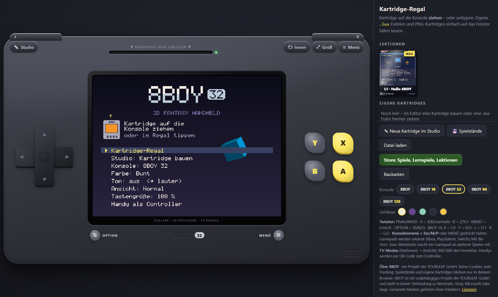
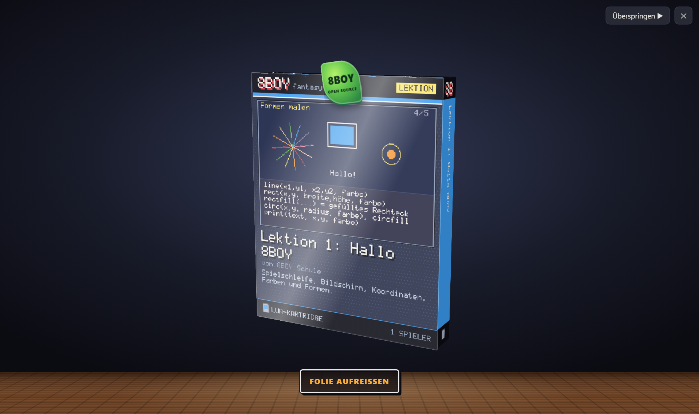
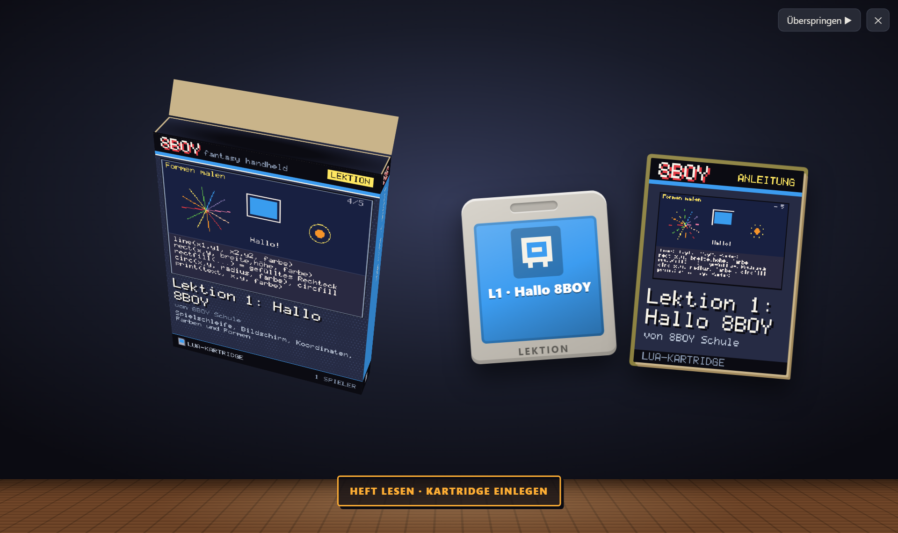
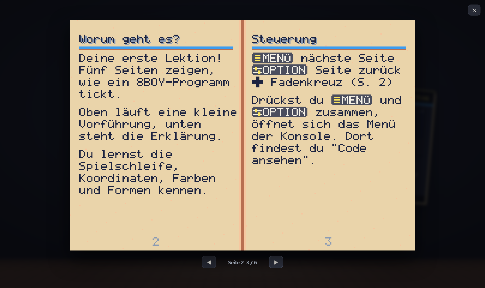
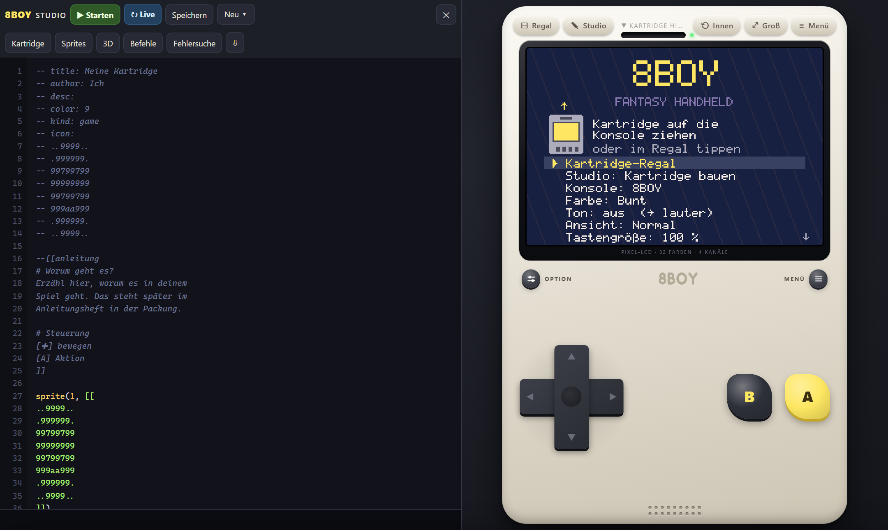

# 8BOY – Fantasy-Handheld im Browser

> 8BOY ist ein unabhängiges Projekt der YOURLEAF GmbH und steht in keiner Verbindung zu Nintendo, Sony, Microsoft oder Sega.
> Genannte Marken gehören ihren Inhabern. *8BOY is an independent project of YOURLEAF GmbH and is not affiliated with
> Nintendo, Sony, Microsoft or Sega. All trademarks belong to their respective owners.*

> **English:** 8BOY is a family of fantasy consoles that runs in the browser as an installable PWA. Games are Lua
> cartridges you drag onto the console – with mouse or finger. It ships with lessons, games and two open educational
> games, a built-in studio (code editor, sprite painter, 3D workshop), boxed cartridges with manuals and PNG
> cartridges. Code MIT, content CC BY-SA 4.0. No build step, no tracking.



**Spielen:** <https://8boy.yourleaf.de> · **Lizenz:** Code MIT, Inhalte CC BY-SA 4.0 · **Mitmachen:** [CONTRIBUTING.md](CONTRIBUTING.md)

8BOY ist eine Spielkonsole im Stil der 90er-Handhelds: 240×160 Pixel, 32 Farben, vier Synthesizer-Kanäle.
Kartridges sind Lua-Programme. Man zieht sie aus dem Regal in den Schacht; beim ersten Mal packt man sie aus:
Folie aufreißen, Deckel auf, Anleitungsheft durchblättern, einlegen. Jede Kartridge ist zugleich ihr eigener
Quelltext und lässt sich im eingebauten **8BOY Studio** öffnen, ändern und als eigene speichern.

| | |
|---|---|
|  |  |
|  |  |

## Was drin ist

- **Konsole als PWA:** läuft offline, quer und hoch, Großbild- und TV-Modus, Touch mit mehreren Fingern, Tastatur,
  Gamepads (bis zu vier Spieler) und das Handy als Controller.
- **8BOY Studio:** Editor mit Vervollständigung und Parameterhilfe, Fehlersuche mit Haltepunkten,
  Sprite-Malprogramm, 3D-Werkstatt (OBJ/glTF), Etikett-Formular, Vorlagen.
- **Baukasten** (`baukasten.html`): Spiele ohne Code zusammenklicken – heraus kommt eine echte Lua-Kartridge.
- **Packungen und Anleitungshefte:** Jede Kartridge hat eine Packung mit Titelbild und ein Heft zum Blättern.
- **PNG-Kartridges:** „⇩ Packung“ im Regal speichert ein Bild der Packung, in dem das Spiel steckt. Wer das Bild auf
  die Konsole zieht, bekommt das Spiel ausgeliefert – ideal zum Verschicken.
- **Konsolenfamilie:** Eine Kartridge nennt im Kopf ihre Konsole (`-- system: …`); ältere Kartridges laufen auf
  größeren Konsolen in einem Rahmen weiter.

| Konsole | `system` | Bildschirm | Besonderes |
|---|---|---|---|
| **8BOY** | 8 | 240×160, 32 Farben | 4 Synth-Kanäle, Tasten A B MENÜ OPTION |
| **8BOY 16** | 16 | 256×224, 256 Farben | 4 Kartenebenen, Perspektivboden, Drehen/Zoomen, Transparenz, 8 Kanäle mit Klangproben, X Y L R |
| **8BOY 32** | 32 | 320×240 | 3D in Software (z-Puffer, Licht, Nebel, Texturen), 16 Kanäle |
| **8BOY 64** | 64 | 640×360 | Grafikchip über WebGL2: Licht je Bildpunkt, Schatten, Nachbearbeitung, UI-Ebene mit scharfer Schrift |
| **8BOY 128** (in Arbeit) | 128 | 1280×720 | Materialien, HDR, Figuren mit Skelett, Asset-Pakete; sichtbar nur lokal oder mit `?giga` |

## Lokal starten

Voraussetzung: Node.js 22 (ab 20.11). Die Konsole selbst braucht keinen Build-Schritt.

```bash
npm install          # nur Werkzeuge für Tests (fengari für Node, Playwright für Browser-Tests)
npm start            # http://localhost:8080 – im WLAN zeigt der Server zusätzlich seine Adresse für Handys
npm test             # alle Kartridges ohne Browser, je einige tausend Bilder mit Zufallseingaben
npm run check        # dazu Kompatibilität Bild für Bild und die Mehrspieler-Lobby
npm run lobby        # Lobby für Mehrspieler und Handy-Controller im Heimnetz (Port 8787)
npm run build        # statischer Stand in dist/ zum Hochladen auf einen Webserver
```

Tastatur: Pfeile/WASD · A = X/K/Leertaste · B = Z/Y/J · MENÜ = Enter/E · OPTION = Shift/Q ·
8BOY 16: X = C/I · Y = V/U · L = F/1 · R = G/2 · Konsolenmenü = Esc/M/P oder MENÜ gedrückt halten.

In Lua heißen die beiden kleinen Tasten `MENU` (6) und `OPTION` (7). Die älteren Namen `START` und `SELECT` gelten
weiter (gleiche Nummern), ebenso die Heft-Symbole `[START]` und `[SELECT]` neben `[MENU]`/`[MENÜ]` und `[OPTION]`.

Mehrspieler über das Internet, „Handy als Controller“ außerhalb des Heimnetzes und Geschenk-Links brauchen eine
Gegenstelle. Wie man sie selbst betreibt und die Konsole darauf einstellt (`config.js`), steht in
[docs/SELBST-BETREIBEN.md](docs/SELBST-BETREIBEN.md).

## Eine Kartridge schreiben

Im Regal „✎ Neue Kartridge im Studio“ wählen – oder eine `.lua`-Datei auf die Konsole ziehen. Gerüst:

```lua
-- title: Meine Kartridge
-- author: Ich
-- desc: Ein Satz für das Regal.
-- color: 12            Farbe des Etiketts (0–31)
-- kind: game           game | tutorial
-- system: 8            8 | 16 | 32 | 64 (ohne Angabe 8)
-- cover: 4 A@2         Titelbild der Packung: nach 4 s fotografieren, vorher A drücken
-- icon:
-- ..cccc..
-- .c....c.

--[[anleitung
# Worum geht es?
Kurzer Text fürs Heft. Tasten als Symbole: [A] [B] [MENU] [OPTION] [✚] [←] [→] [↑] [↓]

# Tipps
- Aufzählungen mit "- "
]]

function _init() end
function _update() if btnp(A) then sfx("jump") end end
function _draw() cls(1) printc("Hallo!", 76, 7) end
```

| | |
|---|---|
| Sprache | Lua 5.3 ([fengari](https://github.com/fengari-lua/fengari)), abgeschottet: kein `io`, `os`, `require`, `js`; Zeitlimit je Aufruf |
| Sprites | bis 256, beliebige Größe, als Text (`.` durchsichtig, `0-9 a-v` = Farbe) |
| Karte | 256×128 Kacheln (`mset`, `mget`, `map`, `fset`/`fget`) |
| Klang | Puls, Dreieck, Säge, Rauschen; Melodien in MML (`play`) |
| Speicher | `store`/`fetch` je Kartridge, nur im Browser (localStorage) |
| Mehrspieler | `btn(taste, spieler)`, `players()`; über das Netz `net.*` |

Alle Befehle stehen in `js/api-docs.js`; daraus speisen sich die Hilfe im Studio und die Vervollständigung.
Die Lektionen aus [8boy-lernspiele](https://github.com/yourleaf-gmbh/8boy-lernspiele) führen Schritt für Schritt durch alles – von „Hallo 8BOY“ bis zu Shadern auf dem 8BOY 64.

## Kartridges und Kataloge

Dieses Repository enthält nur die Konsole und eine Beispiel-Kartridge („Lektion 1: Hallo 8BOY“). Lektionen,
Konzept-Demos und die Lernspiele „Stadtpark 8-Bit“ und „Datenspur“ liegen im Repository
[8boy-lernspiele](https://github.com/yourleaf-gmbh/8boy-lernspiele) (Code MIT, Inhalte CC BY-SA 4.0).

Der Store der Konsole lädt weitere Kartridges aus **Katalogen**. Einen Katalog bindet man in `config.js` ein:

```js
window.EIGHTBOY_CONFIG = { katalogUrl: 'https://example.org/8boy-lernspiele/katalog.json' };
```

Lokal mit beiden Repositories nebeneinander:

```bash
node tools/serve.mjs 8094 ../8boy-lernspiele     # Katalog auf http://localhost:8094/katalog.json
# config.js: katalogUrl: 'http://localhost:8094/katalog.json'
npm start                                        # Konsole auf http://localhost:8080
```

Wie ein Katalog aufgebaut ist und wie man eigene Kartridges einbindet: [docs/KARTRIDGES-EINBINDEN.md](docs/KARTRIDGES-EINBINDEN.md).

## Aufbau

```
index.html, css/                Gehäuse (quer/hoch), Regal, Store, Studio, Auspacken, TV-Modus
config.js                       Einstellungen der Instanz (Lobby-Adresse, Impressum …), Beispiel: config.example.js
js/main.js                      Verdrahtung, Touch, Drag & Drop, Layout, Konsolenwechsel
js/machines.js                  Steckbriefe der Konsolen, wer passt in welchen Schacht
js/system.js                    Betriebssystem: Boot, Startmenü, Laden, Pause, Fehlerbildschirm
js/vm.js                        Lua-Brücke und API
js/gfx.js, gfx3d.js, gpu.js     Grafikchips (2D, Software-3D, WebGL2)
js/audio.js                     Synthesizer, Klangproben, MML
js/net.js, padnet.js, dock.js   Mehrspieler, Handy als Controller, TV-Modus
js/editor.js, pixel-editor.js, model-editor.js, api-docs.js   8BOY Studio
js/baukasten/                   Baukasten (Spiele ohne Code)
carts/, covers/                 Beispiel-Kartridge und Titelbild; Listen: index.json (Regal), store.json, giga.json
assets/                         Asset-Pakete des 8BOY 128, auch für die 128er-Lektionen (Quellen in tools/giga/)
server/lobby.mjs                Lobby: Mehrspieler, Handy-Controller, Geschenk-Links (Node, ohne Abhängigkeiten)
tools/                          Entwicklungsserver, Tests, Packungs-Werkzeug, Quellen der Asset-Pakete (tools/giga/)
vendor/                         fengari-web, Schrift Atkinson Hyperlegible
```

Weitere Werkzeuge:

```bash
node tools/pack.mjs covers            # Titelbilder neu fotografieren (Server muss laufen)
node tools/pack.mjs packages          # PNG-Kartridges nach pakete/
node tools/render-cart.mjs carts/01-hallo.lua bild.png   # Kartridge ohne Browser als Bild
node tools/test-e2e.mjs               # Ende-zu-Ende im Browser: auspacken, Heft, spielen, PNG, Studio
```

## Mitmachen

Beiträge sind willkommen – neue Kartridges, Lektionen, Fehlerbehebungen, Übersetzungen. Wie es geht, steht in
[CONTRIBUTING.md](CONTRIBUTING.md). Es gilt der [Verhaltenskodex](CODE_OF_CONDUCT.md). Sicherheitslücken bitte
nicht öffentlich melden, sondern wie in [SECURITY.md](SECURITY.md) beschrieben.

## Lizenz

- **Programmcode** (Konsole, Werkzeuge, Lobby-Server und der Lua-Code der Kartridges): [MIT](LICENSE),
  © 2026 YOURLEAF GmbH.
- **Inhalte** (Grafiken, Texte und Melodien der Beispiel-Kartridge, Titelbilder, Symbole, Bilder der
  Dokumentation): [CC BY-SA 4.0](LICENSE-CONTENT), © 2026 YOURLEAF GmbH.
- **Asset-Pakete** des 8BOY 128 (`assets/`): CC0 1.0, wie in ihren Manifesten angegeben.
- **Bestandteile von Dritten** (fengari-web, sprintf-js, Atkinson Hyperlegible): siehe [THIRD_PARTY.md](THIRD_PARTY.md).

Zitieren: siehe [CITATION.cff](CITATION.cff).

## Herausgeber

YOURLEAF GmbH · Zur Zugbrücke 2 · 26203 Wardenburg · <support@yourleaf.de>
